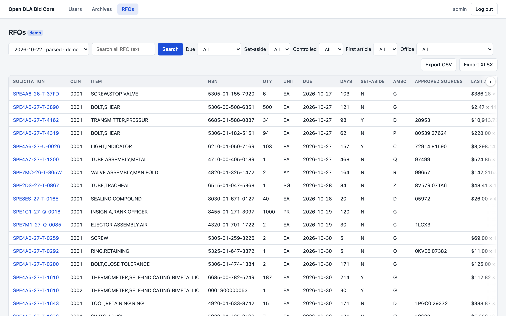
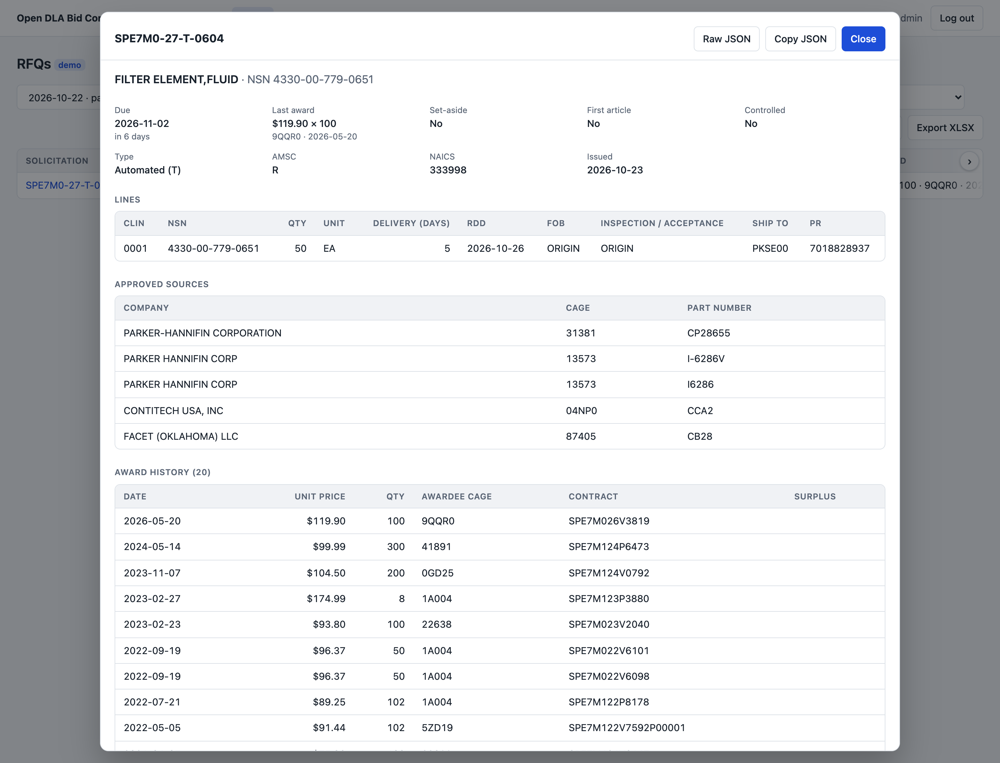

# Open DLA Bid Core

**Every morning, the day's DLA RFQs in one searchable table, on your own machine.**

> [!IMPORTANT]
> **Check it against your own policies before you use it.** Have your IT, security or compliance team confirm that running it fits your company's policies and obligations. Points for their review:
>
> - It downloads every RFQ of the day. Some are marked as involving CUI or export-controlled technical data; the app flags them.
> - Data at rest is not encrypted, and there is no audit log or signed release yet.
> - Access control is basic: the app serves plain HTTP, every account can add and delete users, and failed logins are not limited.
> - The job reads DIBBS's public pages automatically and clicks through the DoD consent banner. Make sure that fits DLA's terms and your own rules.
>
> [docs/ARCHITECTURE.md](docs/ARCHITECTURE.md#trust-boundaries-and-data-classification) describes its data flows and trust boundaries. The software is provided as is, without warranty (see the [license](LICENSE)). Nothing here is legal or compliance advice.

> [!NOTE]
> Open DLA Bid Core is an independent project. It is not affiliated with or endorsed by the Defense Logistics Agency (DLA) or the Department of Defense (DoD).

> [!NOTE]
> **Meaningful contributions are welcome**, from parser fixes to whole roadmap modules. See [Contributing](#contributing).

## Contents

- [Overview](#overview)
- [Quick start](#quick-start)
- [What it does](#what-it-does)
- [Settings and users](#settings-and-users)
- [Your data](#your-data)
  - [Disk use](#disk-use)
  - [Back up and restore](#back-up-and-restore)
  - [Upgrade](#upgrade)
- [Develop](#develop)
- [Contributing](#contributing)
- [License](#license)

## Overview

DIBBS posts thousands of RFQ PDFs a day (3,347 on 2026-10-22), and finding the ones worth quoting means opening them one by one. Open DLA Bid Core downloads each day's RFQs overnight. It parses every PDF into lines with what a bid/no-bid call needs:

- approved sources (CAGE + part number)
- quantity, due date, set-aside and AMSC
- first article and controlled-data flags
- the last award price for the NSN

You search and filter one table instead.

It is for small and mid-size DLA distributors, resellers and manufacturers who quote on DIBBS. It is free and open source (Apache-2.0) and runs on your own machine. It needs no DIBBS login. The only outside site it talks to is DIBBS's public download pages, so your searches and data stay with you.



*The RFQs page. Search covers all RFQ text. You can filter by due date, set-aside, controlled data, first article and office, and export the filtered rows to CSV or XLSX.*



*Click a solicitation to see the whole RFQ: key facts, its lines, approved sources with part numbers, and every award on file for its NSN.*

**Status:** early. It covers finding and reading RFQs. The rest of the bid cycle is on the [roadmap](docs/ARCHITECTURE.md#roadmap).

## Quick start

You need Docker.

```bash
git clone https://github.com/cybor97/rfqcrm.git
cd rfqcrm
docker compose up -d --build
```

The admin password is printed once, on first start:

```bash
docker compose logs app | grep "Created user admin"
```

Open <http://localhost:3000> and log in as `admin`.

The first start loads a demo day, so the RFQs page has data right away: 102 real RFQs from 2026-10-22. The job fetches each new DIBBS day at 03:00 New York time. To fetch the latest day now (about 1.4 GB), click **Run job now** on the Archives page.

Next steps:

- Review [access and user accounts](#settings-and-users) before anyone else uses it.
- [Set up backups](#back-up-and-restore).

## What it does

- **Daily job** (03:00 New York time). It fetches the day's RFQ PDFs and its daily index from DIBBS's public pages. No DIBBS login is used or stored.
  - The first run takes only the newest day, not DIBBS's whole month.
  - Later runs take every day since.
- **RFQ parser.** It turns every PDF into:
  - lines (CLINs)
  - approved sources (CAGE + part number)
  - requirement codes, packaging and first article
  - clauses and procurement history

  It was checked against all 3,347 RFQs of 2026-10-22.
- **RFQs page.** One row per line, with:
  - its due date, taken from the daily index (which beats the PDF for a re-posted RFQ)
  - set-aside code, AMSC and approved-source CAGEs
  - the latest known award (price × quantity · CAGE · date)
  - flags for controlled data (CUI or export control) and first article

  Search covers all RFQ text. Filters narrow the rows. Export saves every matching row, not just the current page.

  Click an RFQ to see its full record and every award on file for its NSN. You can also download its PDF there.
- **Archives page.** One row per DIBBS day, with the files it skipped and why, and when the job last reached DIBBS.
  - Add a day the job missed.
  - Set a day back to `pending` to download it again, or to `downloaded` to parse it again.
- **Demo data.** On first start the app shows a demo day: 102 real RFQs from 2026-10-22, tagged demo.
  - The job skips it.
  - Adding 2026-10-22 on the Archives page, while DIBBS still lists that day, replaces it with the real day.
- **DIBBS consent banner.** DIBBS shows a DoD Notice and Consent banner before any download. The job clicks through it the way a browser user would. You remain responsible for using DIBBS within DLA's terms.

Not built yet:

- matching to your catalog
- supplier outreach
- pricing
- the quote checker
- the batch-quote file

[docs/ARCHITECTURE.md](docs/ARCHITECTURE.md) has the design and the roadmap.

## Settings and users

**Settings.** Put these in a `.env` file next to `compose.yaml`, then run `docker compose up -d`:

- `BIND`: the address the app listens on. The default, `127.0.0.1`, lets only this machine reach it. Change it only if your IT or security policy allows access from other machines, and then only to an internal address. Never expose the app to the internet.
- `PORT`: changes the port.
- `ADMIN_PASSWORD`: sets the admin password (see below).

**Access from other machines.** The app serves plain HTTP. If your policy allows other people to use it, reach it only through a setup your IT team approves, such as an HTTPS reverse proxy or a VPN.

**User accounts.** Give each person their own account on the Users page, and only when your access policy allows it. Every account has the same full rights, including adding and deleting users. Delete accounts that are no longer needed.

**Setting or resetting the password.** To choose the password yourself, or to reset a lost one:

1. Set `ADMIN_PASSWORD` in `.env`.
2. Run `docker compose up -d`. A plain `docker compose restart` keeps the old settings.

The password is applied on every start while it is set.

**Signing everyone out.** A password reset doesn't end sessions that are already open. To sign everyone out too, for example after a leak or when someone who knew the password leaves:

1. Run `docker compose exec app rm data/jwt.secret`.
2. Run `docker compose up -d`. A new key is made at start.
3. Delete any user you don't recognize on the Users page.

## Your data

Everything lives in the Docker volume `open-dla-bid-core_data`:

- the SQLite database
- the login session key (`jwt.secret`)
- each day's PDFs

**Never run** `docker compose down -v`**.** The `-v` deletes the volume and every parsed day with it.

### Disk use

Expect about 1.4 GB of PDFs per DIBBS day plus about 80 MB of database. The PDFs are kept so that a day can be parsed again and its PDFs downloaded. To free space, delete old day folders:

```bash
docker compose exec app rm -r data/archive/ca261022
```

The RFQs stay. That day can no longer be parsed again, and its PDFs can no longer be downloaded.

### Back up and restore

Back up before upgrading. `data.tgz` holds your login key and password hashes, so keep it private:

```bash
docker compose stop
docker compose run --rm --no-deps -u root -v "$PWD":/backup app sh -c 'umask 077 && tar czf /backup/data.tgz -C data .'
docker compose start
```

To restore, with the app stopped:

```bash
docker compose run --rm --no-deps -u root -v "$PWD":/backup app tar xzf /backup/data.tgz -C data
```

### Upgrade

1. Back up.
2. Get the new version (`git pull`).
3. Run `docker compose up -d --build`. Database migrations run at start.

To roll back, go back to the previous version and restore the backup.

## Develop

You need Node 22.18+ or 24.11+ (the Docker image uses Node 24) and `unzip` on PATH (built into macOS; `apt install unzip` on Debian/Ubuntu).

```bash
npm install
npm run dev     # API on http://localhost:3000/api, web on http://localhost:5173 (proxies /api)
```

- **Tests:**
  - backend unit: `npm test -w backend`
  - backend end-to-end: `npm run test:e2e -w backend`
  - frontend type check: `npm run check -w frontend`

  Tests use an in-memory database.
- **Database:** `backend/data/rfqcrm.sqlite`. The schema comes from the migrations in `backend/src/migrations`, which run at start. After changing an entity:
  1. Run `npm run migration:generate -w backend -- src/migrations/<Name>`.
  2. Add the new class to `migrations` in `backend/src/data-source.ts`.
- **Login:** the session is an HttpOnly JWT cookie signed with `backend/data/jwt.secret`, which is generated on first start. Every API route needs it unless marked `@Public()`.
- **Parser CLI:** `npm run build -w backend`, then `node backend/dist/parser/parse.js <out-dir> <pdf>...`. It writes one JSON per PDF into an existing folder.
- **Where things are:**
  | Part | Path |
  |---|---|
  | M1 ingest | `backend/src/ingest` |
  | M3 parser | `backend/src/parser` |
  | M2 store | `backend/src/solicitations`, `migrations`, `data-source.ts` |
  | Web UI | `frontend/src/routes` |

  The modules are described in [docs/ARCHITECTURE.md](docs/ARCHITECTURE.md).

## Contributing

Meaningful contributions are welcome, for example:

- fixes for RFQs the parser reads wrong, with that RFQ as a test file
- modules from the [roadmap](docs/ARCHITECTURE.md#roadmap), such as catalog matching or the batch-quote file
- bug reports with steps to reproduce

For anything bigger than a small fix, open an issue first so we can agree on the approach. Run the [tests](#develop) before you open a pull request.

Test files must be public DIBBS RFQs without CUI markers or restricted distribution statements. Never add drawings or technical data.

## License

[Apache-2.0](LICENSE).
