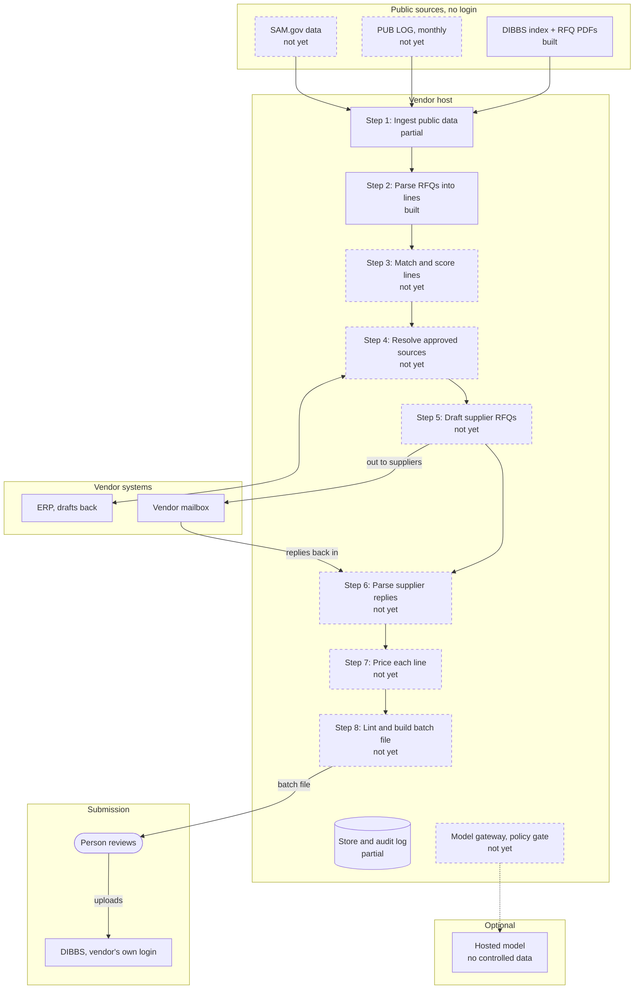

# Open DLA Bid Core architecture

This is the design of Open DLA Bid Core. Status columns record what exists today. To install and run it, see the [README](../README.md).

## Summary

Open DLA Bid Core is a self-hosted, Apache-2.0 toolkit that takes a DLA reseller from each morning's DIBBS RFQs to a checked batch-quote file. Prices, supplier data and credentials never leave the vendor's network.

It covers public-data ingest, RFQ parsing, supplier outreach, pricing and compliance checks. It stops short of submission: a person uploads the file to DIBBS under the vendor's own account. It targets small and mid-size DLA distributors and manufacturers.

Today it does the first stage: each day's DIBBS RFQs become searchable lines with approved sources, due dates, set-asides and past awards.

## Goals and non-goals

v1 succeeds when a small reseller quotes all its matched RFQs each day from one install, each quote traceable to sources and rules.

Goals:

- Turn each day's DIBBS postings into a ranked bid queue, matched to the vendor's catalog and suppliers.
- Draft supplier RFQs that carry the solicitation's requirements, and turn supplier replies into structured quotes.
- Propose prices from supplier cost and local procurement history, with every number explained.
- Catch quote errors that would drop a bid out of automated evaluation, before upload.
- Produce a batch-quote file that passes DLA's published format rules.
- Run entirely on hardware or a cloud tenant the vendor controls.

Non-goals:

- Logging in to DIBBS, storing DIBBS credentials or submitting quotes.
- Fetching or processing restricted technical data (anything beyond Distribution A) in v1.
- Pooling data across vendors, or running any hosted multi-tenant service from the core.
- Replacing the vendor's ERP: the core reads from it and drafts back, and the ERP stays the system of record.
- Giving legal or contracting advice: rules cite DLA text, and the vendor owns its representations.

## Trust model and design principles

The core earns trust by design: it runs on vendor machines, holds no DIBBS credentials, sends data only where configured, and explains every number.

- **Self-hosted only.** No telemetry, no phone-home, no hosted dependency. Updates are signed and pulled by the vendor.
- **Vendor-owned credentials.** DIBBS logins never enter the system. Mailbox, ERP and SAM.gov credentials sit in the vendor's secret store with least-privilege scopes.
- **People at the irreversible steps.** Sending to a new supplier and uploading quotes need a person. Auto-send is opt-in, per allowlisted supplier.
- **Rules first, models second.** Parsing and checks use published formats and deterministic rules. Models handle free text only, and their output is shown beside the source text.
- **Every rule cites its source.** Each check names the DLA document, revision and clause it enforces.
- **Controlled data never leaves the host.** A policy gate in the model gateway and the mail sender blocks it from every external destination.
- **Everything is audited.** RFQs, emails, model calls, prices and generated files are logged with their inputs and software versions.

As built: no telemetry, no DIBBS login, and no models. The audit log, the policy gate and signed updates are not built yet.

## System overview

The core is one pipeline inside the vendor's host. Public sources feed it, the vendor's mailbox and ERP sit beside it, and DIBBS is reached only by a person.

Bids leave the vendor network only as a file a person uploads to DIBBS. Dashed boxes are not built yet.

### Daily bid cycle

Each day runs these steps in order; each names the module that does it.

1. Pull the new DIBBS daily index and RFQ PDFs (M1). Refresh PUB LOG monthly and SAM.gov data on a schedule.
2. Parse each RFQ into lines with approved sources, quantity, delivery days, set-aside and requirement flags (M3).
3. Match lines to the vendor's catalog, supplier coverage and eligibility, then score and queue bid candidates (M4).
4. Resolve each approved-source CAGE code to a company and to the vendor's own supplier contacts (M5).
5. Draft supplier RFQs, sent after approval or automatically to allowlisted suppliers (M6).
6. Parse supplier replies and DLA notices into structured records, routing low-confidence results to review (M7).
7. Price each line from supplier cost, margin rules and procurement-history bands (M8).
8. Lint each draft quote against the RFQ and the Master Solicitation revision in effect (M9).
9. Build the batch-quote file; a person reviews it and uploads it to DIBBS before the return date (M10).
10. Record awards and later procurement history as wins, losses and price-to-win (M11).

As built, a cron at 03:00 New York time runs steps 1 and 2 for DIBBS.

## Modules

Thirteen modules, each behind a small interface, so every trust-sensitive step can be tested and replaced on its own.

| Module | What it does | Reads | Writes | Guardrail | Status |
|---|---|---|---|---|---|
| M1 Ingest | Fetches the DIBBS daily index and RFQ PDFs, PUB LOG releases and SAM.gov data; keeps raw files with hashes | Public sources | Raw store | Rate-limited, runs from the vendor's network, never logs in | Partial. Each day's DIBBS RFQ PDFs (`ca` zip) and daily index (`in` file) are fetched from the vendor's network, clicking through DIBBS's DoD consent banner. No login. PDFs and the index are kept; each solicitation stores its PDF's sha256. Downloads run one at a time, with no rate limit yet. No PUB LOG, SAM.gov or award search yet. |
| M2 Store | Normalized records plus the raw-file archive, each tagged with provenance and data class | All modules | Records | Encrypted at rest; data class set on write | Partial. Solicitation, Line, ApprovedSource and AwardHistory live in SQLite through TypeORM migrations. Every parsed solicitation carries sha256 + parser version provenance, and every solicitation a controlled flag. Not encrypted at rest yet. No AuditEvent, Item, CageEntity, Supplier or the other entities yet. |
| M3 RFQ parser | Extracts lines, approved sources (CAGE + part number), quantity, unit, delivery days, set-aside, first article, packaging and procurement history | RFQ PDFs, index | Solicitation, Line, ApprovedSource, AwardHistory | Deterministic first; model output linked to its page and text | Built. Deterministic, on pdf.js. Extracts lines, approved sources (CAGE + P/N), requirement codes, packaging, first article, clauses and procurement history. No models. |
| M4 Matcher | Scores bid/no-bid on approved-source coverage, catalog fit, set-aside eligibility, delivery feasibility and margin floor | Lines, vendor profile, suppliers | BidCandidate with reasons | Every score lists its reasons; thresholds set by the vendor | Not yet |
| M5 Source resolver | Maps approved CAGE codes to companies and to the vendor's supplier contacts; proposes supplier-master merges | ApprovedSource, CAGE data, ERP suppliers | SourceMatch, merge proposals | Merges reach the ERP only after approval | Not yet |
| M6 Outreach | Drafts supplier RFQs carrying quantity, delivery, first article, packaging and traceability terms; sends through the vendor mailbox | Lines, SourceMatch | OutboundRequest | Approval queue; auto-send only to allowlisted suppliers; per-domain rate limits | Not yet |
| M7 Reply parser | Extracts price, quantity breaks, lead time, minimum order, validity, traceability and origin; also reads DLA notices such as return-date extensions | Mailbox | SupplierQuote, Notice | Confidence score; low confidence goes to review | Not yet |
| M8 Pricing | Proposes a unit price from supplier cost, margin rules and procurement-history bands | SupplierQuote, AwardHistory | PriceProposal with explanation | Shows the band, recent awards and margin; flags outliers | Not yet |
| M9 Quote linter | Checks each draft quote against RFQ terms, the Master Solicitation revision and batch-format rules | BidDraft | LintResult with clause cited | Errors block packaging; rule packs versioned by revision | Not yet |
| M10 Batch packager | Writes the DIBBS batch-quote upload file and a manifest of its contents | Approved BidDrafts | Upload file, manifest | Never uploads; validates characters, field order and conditional rules | Not yet |
| M11 Outcomes | Records awards, wins, losses, price-to-win and supplier performance | DIBBS awards, later RFQ history, SAM.gov awards | Outcome, reports | Local only | Not yet |
| M12 Connector SDK | Adapters for mail (IMAP/SMTP, Microsoft Graph, Gmail API) and ERP (CSV, SQL views, REST) | Vendor systems | Drafts in vendor systems | Read-only by default; writes are drafts for approval | Not yet |
| M13 Model gateway | One interface to local or hosted models, with prompt templates and logging | Tasks from M3, M6, M7 | Model outputs, logs | Data-class policy gate; provider allowlist set by the vendor | Not yet |

Code: M1 in `backend/src/ingest/`, M2 in `backend/src/solicitations/`, `backend/src/migrations/` and `backend/src/data-source.ts`, M3 in `backend/src/parser/`.

## Data model

Every entity carries a data class, and that class decides where its records may travel (see [Trust boundaries](#trust-boundaries-and-data-classification)).

| Entity | Key fields | Source | Data class | Status |
|---|---|---|---|---|
| Solicitation | Number, type, issue and return dates, buyer code, set-aside, automated flag, Master Solicitation revision | DIBBS index, RFQ PDF | Public | Partial: no automated flag or Master Solicitation revision yet |
| Line | Line number, NSN, nomenclature, quantity, unit, delivery days, destination, purchase request | RFQ PDF | Public | Partial: destination stays in the parser JSON |
| ApprovedSource | Line, CAGE code, part number | RFQ PDF | Public | Built |
| Item | NSN, FSC, item name, reference numbers (CAGE + part number), characteristics | PUB LOG | Public | Not yet |
| CageEntity | CAGE code, name, address, status, SAM registration and exclusion flags | PUB LOG, SAM.gov | Public | Not yet |
| AwardHistory | NSN, contract number, awardee CAGE, quantity, unit price, date | RFQ PDFs, DIBBS awards | Public | Partial: from RFQ PDFs only |
| Supplier | Company, contacts, CAGE links, lines carried, response history | ERP, mailbox | Vendor-confidential | Not yet |
| OutboundRequest | Line, supplier, message, requirements sent, approver, sent time | Core, mailbox | Vendor-confidential | Not yet |
| SupplierQuote | Price, quantity breaks, lead time, minimum order, validity, traceability, origin, confidence | Mailbox | Vendor-confidential | Not yet |
| BidDraft | Line, chosen quote, unit price, delivery days, bid type, representations, lint results, approver | Core | Vendor-confidential | Not yet |
| Submission | Batch file hash, quotes included, uploader, upload time as entered | Core, person | Vendor-confidential | Not yet |
| Outcome | Won or lost, winning price where public, realized margin | DIBBS awards, ERP | Mixed | Not yet |
| TechDataRef | Link to the technical data package, distribution statement, JCP-required flag; no file content in v1 | RFQ PDF | Controlled (reference only) | Not yet |
| AuditEvent | Actor, action, input hashes, software and rule versions | All modules | Vendor-confidential | Not yet |

A Solicitation has many Lines. Each Line points to one Item and has many ApprovedSources, each tied to a CageEntity. SupplierQuote ties a Supplier to a Line, and BidDraft ties a Line to its chosen SupplierQuote.

The schema ships as SQL migrations plus JSON Schema, so other tools can read and write the same records.

As built:

- TypeORM migrations create the schema at startup. JSON Schema is not written yet.
- Solicitation also stores the AMSC, first article, sha256, parser version and the whole parser JSON, so fields without a column are kept.
- The only data class stored is the controlled flag on Solicitation. All RFQ data stored so far is public.
- AwardHistory rows are deduplicated across days.

## Data sources and access rules

Every v1 feed is public; the one gated source, restricted cFolders data, stays out of scope.

| Source | What the core takes | Access | Refresh | Limits and notes | Status |
|---|---|---|---|---|---|
| DIBBS daily RFQ index | Solicitation number, NSN or part number, short nomenclature, quantity, unit, purchase request, return date, buyer code, AMSC, set-aside, PDF name | Public, no login ([third-party docs](https://apify.com/crawloop/dibbs-rfq-scraper)) | One file per posting date; 3,446 rows on 2026-10-22 | No DLA format document found; the parser is tested against recorded fixtures | Partial: due date, set-aside and AMSC; the other fields come from the PDF |
| DIBBS RFQ pages and solicitation PDFs | Line detail, approved sources, clauses and procurement notes, CUI and export-control flags, procurement history | Public | Per posting | Quoting and drawings sit behind login ([APEX training](https://business.utah.gov/wp-content/uploads/dibbs-training-012424.pdf)) | RFQ PDFs: built |
| DIBBS award search | Awardee and award details per solicitation | Public ([DLA](https://www.dla.mil/Working-With-DLA/Applications/Details/Article/2921495/dibbs-dla-internet-bid-board-system/)) | Daily | Feeds outcomes and price history | Not yet |
| [PUB LOG](https://www.dla.mil/Information-Operations/Services/Applications/PUB-LOG/) | FLIS item data, characteristics, NSN to part number to CAGE cross-reference, CAGE and corporate-complex handbooks | Free download; no subscription or CAC; open to the private sector | Monthly | Excludes service-unique, proprietary and NATO data | Not yet |
| SAM.gov public files | Opportunities and exclusions, entity registrations | Public download, no key | Daily; entities monthly ([sam-gov-mcp docs](https://pypi.org/project/sam-gov-mcp/)) | Entities that opted out of public display are missing | Not yet |
| SAM.gov APIs | Targeted entity, exclusion, opportunity and contract-award lookups | Free personal key that expires every 90 days | On demand | 10 calls a day without a SAM role, 1,000 with one; reuse the MIT-licensed [sam-gov-mcp](https://pypi.org/project/sam-gov-mcp/) client | Not yet |
| cFolders technical data | References to drawings and specifications | Separate login; Distribution A open, C and D need JCP (DD Form 2345) | Per solicitation | v1 stores links only; restricted data may be used only to bid or perform, then destroyed | Out of scope for v1 |
| [DLA Master Solicitation](https://www.dla.mil/Acquisition/Policy-and-Directives/) and Master List of Technical and Quality Requirements | Rules every automated RFQ incorporates | Public | Every few months: Rev-104 on 24 Feb 2026, Rev-105 on 20 May 2026; [Master List Rev 45](https://www.dla.mil/Portals/104/Documents/J7Acquisition/DLA_Master_List_of_TQ_Requirements_Oct_21_2026_Rev_45.pdf) on 21 Oct 2026 | Rule packs pinned to each revision | Referenced only; rule packs not yet |

The core reads from the vendor's own network, caches every raw file with its hash, and never uses a vendor login to read. PUB LOG and the SAM.gov files are bulk downloads, so daily matching runs locally without per-call limits.

### DIBBS daily files

DIBBS posts three files per day; the core downloads the first two. Counts are from 2026-10-22.

| File | Contents | Use |
|---|---|---|
| `ca{yymmdd}.zip` | The RFQ PDFs: 3,347 | Downloaded and parsed |
| `in{yymmdd}.txt` | Fixed-width index: one row per solicitation and PR, 140 characters plus CRLF | Downloaded; the source of due date, set-aside and AMSC |
| `bq{yymmdd}.zip` → `bq{yymmdd}.txt` | One prefilled 121-field batch-quote row per CLIN: 3,743 rows | Not yet; the M10 starting point |
| `bq{yymmdd}.zip` → `as{yymmdd}.txt` | Approved sources: NSN, CAGE and P/N | Not yet |

Observed on the 2026-10-22 files:

- For 269 of 3,347 solicitations, the index has a later due date than the PDF. These are re-posted RFQs, so the index wins.
- The index's set-aside code agrees with the PDF's set-aside tick on all 3,347: N when unticked, another code when ticked.
- Codes seen: N 2,879, Y 369, R 43, H 35, L 20, E 1. Their meanings are still to be confirmed from DIBBS documentation.
- The AMSC comes only from the index.

## Trust boundaries and data classification

Three data classes decide what may leave the host: public data anywhere, vendor-confidential data only where the vendor points it, controlled data nowhere.

| Class | Examples | May go to | Never goes to | Storage |
|---|---|---|---|---|
| Public | RFQs, PUB LOG, SAM.gov data, public awards | Any configured model or service | No restriction | Cache; re-fetchable |
| Vendor-confidential | Supplier costs and contacts, margins, bid drafts, outcomes, audit log | The vendor's ERP and mailbox, local models, hosted models the vendor enables | Telemetry, project maintainers, any party the vendor has not configured | Encrypted at rest; vendor-run backups |
| Controlled | CUI and export-controlled technical data, such as Distribution C or D drawings | v1: only links and flags are stored; later, local models only | Hosted models, supplier emails, clear-text logs | Later versions: encrypted, with retention and destruction hooks |

The parser marks a solicitation controlled when it carries DLA's CUI markers (STO RD002 or RQ032) or a restricted distribution statement ([Master Solicitation Rev-104](https://www.dla.mil/Portals/104/Documents/J7Acquisition/MasterSolicitation4ASAcquisitionsRev-104_February-24-2026v1.pdf)). The policy gate in the model gateway and mail sender keys off that mark.

As built, a solicitation is controlled when it has RD002 or RQ032, or an item note carries DISTRIBUTION STATEMENT B to F. No policy gate exists yet, because nothing sends data out.

### Credentials

Each outside system gets the narrowest credential the vendor controls, and DIBBS gets none.

| Credential | Rule |
|---|---|
| DIBBS | None stored or used. DLA's terms bar using another person's email and password, and allow suspension for sharing account information with unauthorized users ([user terms](https://www.dla.mil/Portals/104/Documents/InformationOperations/EBS%20Supplier%20Information/DIBBS%20SuperUser%20Terms%20and%20Conditions_Oct%2028%202024.pdf)). DIBBS does recognize third-party submitters with their own accounts, but the core leaves submission with the vendor. |
| SAM.gov | The vendor's own key in the OS secret store, with a reminder before its 90-day expiry. |
| Mailbox | OAuth on a dedicated sourcing mailbox, scoped to read and send; no stored passwords. |
| ERP | A read-only service account; write-back only as drafts approved inside the ERP. |
| Model providers | A key per provider and an allowlist the vendor controls. |

As built, the core holds no outside credentials: the DIBBS job never logs in, and no other connector exists. The app's own login is a local admin user with a scrypt-hashed password and a JWT secret on the data volume.

## Compliance guardrails

The core enforces DLA's mechanical rules in code and leaves every representation to a named person at the vendor. Rules below come from [Master Solicitation Rev-104](https://www.dla.mil/Portals/104/Documents/J7Acquisition/MasterSolicitation4ASAcquisitionsRev-104_February-24-2026v1.pdf); diff them against [Rev-105](https://www.dla.mil/Portals/104/Documents/J7Acquisition/FinalMasterSolicitationForAutomatedSimplifiedAcquisitionsRevision5-20-26.pdf), current since 20 May 2026, before coding the rule pack.

None is enforced in code yet: that is the quote linter's job (M9).

| DLA rule | Where | Core behavior | Status |
|---|---|---|---|
| Only "bid without exception" quotes qualify for automated award; alternates, exceptions to packaging, FOB, inspection or quantity, and any quote remarks disqualify | Part I, 3(a)(2) | Linter error citing the clause; the line is packaged only if a person marks it a deliberate manual-review bid | Not yet |
| Different delivery days, superseding approved part numbers, and used or surplus items do not disqualify one-time buys | Part I, 3(a)(1) | Shown as information, not errors, to avoid false alarms | Not yet |
| Automated indefinite-delivery ("U") buys also exclude used or surplus items and quotes valid under 90 days | Part II, 1 | Rule pack keyed on solicitation type; the batch validator applies the matching bid-type rule | Not yet |
| First-article and production-lot-test solicitations are never auto-awarded | Part I, 3(c) | Routed to a manual-evaluation queue | Not yet |
| Fast Auto Evaluation can award at or below the micro-purchase threshold from 3 business days after issue; the last tie-breaker is the earliest quote | Part I, 2(h) and 3(d) | These lines sort first; the vendor sets a latency target | Not yet |
| Firms registered in DIBBS within 60 days that quote far above the usual volume for new firms are excluded from all awards | Part I, 3(j) | A daily cap for new CAGEs, on by default for the first 60 days | Not yet |
| Export-controlled items need current JCP certification for the quoter and the manufacturer | Part I, 3(a)(3) | Blocks those lines unless the vendor profile records both certifications | Not yet |
| A quote represents compliance with incorporated reps and certs, including NIST SP 800-171 status when CUI applies; misrepresentation penalties apply | Part I, 2(b); Part III | Representations live in a signed vendor profile checked against SAM.gov; a model never fills them | Not yet |
| Quotes count only through DIBBS, by 3:00 PM Eastern on the return date | Part I, 2(b) | Deadlines computed in Eastern time with a safety margin; late files are flagged | Not yet. Quote due dates come from the daily index, which supersedes the PDF. |
| Suppliers must comply with the revision in effect at award | Part I, 1(a) | Rule packs are versioned, and a new DLA revision raises an alert | Not yet |

## Deployment and operations

One Docker Compose stack on a single machine runs the whole core, with no inbound internet access.

| Item | Spec | Status |
|---|---|---|
| Topology | An app container (API, scheduler, web UI), PostgreSQL, a raw-file store (local disk or S3-compatible), and an optional local model server | Partial. One container runs the API, the in-process scheduler and the SPA. The SQLite file, `jwt.secret` and PDFs live in a named Docker volume. PostgreSQL, S3 and a model server: not yet. |
| Placement | An office server or the vendor's own US-region cloud tenant. Egress goes only to configured sources; the UI is reachable only on the vendor's LAN or VPN | Built. The UI is bound to 127.0.0.1 by default (`BIND` opens it to the LAN). The only egress is DIBBS. |
| Schedule | A morning DIBBS pull and parse, then outreach; a monthly PUB LOG import; daily SAM.gov files. Jobs retry with backoff and report to a local health page | Partial. A cron at 03:00 New York time downloads and parses new days. A failed download retries on the next run. Backoff and health page: not yet. |
| Degraded mode | If DIBBS is unreachable, work continues on cached data and the queue shows how stale it is | Partial. A failed DIBBS check does not block parsing, and the Archives page shows the last check. |
| Updates | Signed releases the vendor pulls when ready; reversible migrations; release notes call out every rule-pack change | Partial. Migrations run at startup. Signed releases: not yet. |
| Backups | PostgreSQL dumps and the raw store go to a vendor-owned target, with a documented restore drill | Partial. The README backs up and restores the whole data volume. pg dumps: not yet. |
| Observability | Local logs and metrics only | Partial. Local logs only, no telemetry. |
| Sizing | Disk needs are set after measuring PUB LOG's footprint on the first import | Partial. RFQ PDFs take about 1.4 GB a day and are kept. PUB LOG is not measured yet. |

## Stack as built

The code is TypeScript and SQLite, which the spec lists as accepted alternatives to Python and PostgreSQL. The existing code was TypeScript.

| Layer | Spec recommends | We use | Why |
|---|---|---|---|
| Language and API | Python 3.12+, FastAPI | Node 24 + TypeScript (NestJS 12) | The spec's alternative is TypeScript end to end, and the existing code was TypeScript. |
| State | PostgreSQL | SQLite through TypeORM and better-sqlite3, with migrations | The spec's alternative for single-user installs: one file, no database server. |
| Jobs | A PostgreSQL-backed queue, such as Procrastinate | `@nestjs/schedule`, an in-process cron | One daily job needs no queue or broker. |
| PDF parsing | pdfplumber, with Tesseract OCR as fallback | `pdfjs-dist` (pdf.js) for PDF text | Apache-2.0, and runs in the same Node process. RFQ PDFs carry text, so no OCR yet. |
| UI | React and TypeScript, served by the API | SvelteKit SPA, served by the API | TypeScript, like the rest; the existing UI was SvelteKit. |
| Packaging | Docker Compose, then a Helm chart | Docker Compose | As the spec; no Helm chart yet. |

Bulk reference data, rule packs and the model client have no stack yet. They come with PUB LOG, M9 and M13.

## Licensing, supply-chain security and governance

Apache-2.0 plus signed, reproducible releases let a defense supplier's IT team verify exactly what it runs.

| Item | Rule | Status |
|---|---|---|
| License | Apache-2.0 for code, rule packs and schemas; its explicit patent grant eases corporate legal review. DLA documents are linked, not copied. | Done |
| Contributions | Developer Certificate of Origin sign-off on every commit; two-maintainer review for any rule-pack change | DCO: Phase 4. No rule packs yet. |
| Releases | Signed artifacts and container images (Sigstore), an SBOM per release (CycloneDX or SPDX), and build provenance. Reproducible builds are a stated goal. | Phase 4 |
| Dependencies | Pinned with hashes, scanned for vulnerabilities, built on minimal base images | Lockfile-pinned dependencies installed with `npm ci`: done. Vulnerability scanning: not yet. |
| Security policy | A SECURITY.md with private disclosure and published response targets | Phase 4 |
| Test data | Fixtures come only from Distribution A public RFQs; CI rejects files carrying restrictive distribution markings | Done by hand: public DIBBS RFQ PDFs without CUI markers or restrictive distribution statements only, never drawings or technical data. No CI check yet. |
| Vendor compliance support | A published data-flow description vendors can reuse in their own security documentation, such as a NIST SP 800-171 system security plan | Partial: this document |
| Governance | A public roadmap | Done: see [Roadmap](#roadmap) |

## Roadmap

Four phases take the core from a first accepted upload to a signed v1.0, each closed by a gate a pilot vendor can verify. No phase starts before the gate above it passes; durations are set once pilot vendors are chosen.

1. **Phase 1, MVP: RFQ to upload file.** Ingest the DIBBS index, RFQ PDFs and PUB LOG; parse lines and approved sources. Quote linter and batch packager; prices entered by hand; audit log from day one.
   Gate: a pilot vendor uploads a generated batch file and DIBBS accepts it.
2. **Phase 2, sourcing loop.** Source resolver, supplier RFQ drafts and reply parsing through the vendor mailbox. Model gateway with the data-class policy gate; approval queue for every send.
   Gate: a pilot week of approved outreach; policy tests show no controlled data leaves.
3. **Phase 3, pricing and outcomes.** Price bands from procurement history, margin rules and outlier flags. Award ingest, win and loss tracking, price-to-win and supplier performance.
   Gate: every price proposal shows its inputs; outcomes reconcile with public awards.
4. **Phase 4, v1.0 hardening.** Stable connector SDK and schema; signed releases with SBOM and build provenance. External security review; install and operations guides.
   Release gate: review findings closed; pilot vendors run signed releases.

The current code delivers part of Phase 1: DIBBS index and RFQ PDF ingest, and parsing into lines and approved sources. Phase 1 still needs PUB LOG, the quote linter, the batch packager, hand-entered prices and the audit log.

## Risks and open questions

The largest risks sit in DLA's formats and access rules, not in the code.

| Risk | Impact | Mitigation |
|---|---|---|
| DIBBS index or PDF layouts change without notice | The parser fails silently | Fixture suite from recorded files; schema checks alert on drift |
| DIBBS may throttle or refuse automated connections, especially from non-US or datacenter IPs | Missed postings | Run from the vendor's network; backoff; staleness alarms |
| The batch-quote specification lives in a DLA document that changes | Rejected uploads | Validate against the current spec; the MVP gate is an accepted real upload |
| Model errors in reply parsing | Wrong costs reach a bid | Confidence thresholds, human review, source text beside every value |
| Outreach volume trips spam filters | Lost supplier replies | Dedicated mailbox, per-domain caps, honest sender identity |
| The new-vendor volume rule (Part I, 3(j)) | A new CAGE's quotes are excluded from award | Default cap for new CAGEs |
| Automated reading of public DIBBS pages draws objections | Access blocked | Counsel reviews DLA's terms before the pilot |

Open questions:

- Obtain the current DIBBS batch-quote specification and confirm the full field list.
- Compare that specification with the 121-field `bq` rows DIBBS prefills each day.
- Confirm the set-aside code meanings (N, Y, H, L, R, E) from DIBBS documentation.
- Diff Master Solicitation Rev-105 against Rev-104 and update the rule pack.
- Measure PUB LOG's download and import footprint.
- Decide whether a later version handles restricted technical data locally, and under which controls.
- Choose pilot vendors and record their ERP and mailbox mix.

## References

- [DLA Master Solicitation for Automated Simplified Acquisitions, Rev-105](https://www.dla.mil/Portals/104/Documents/J7Acquisition/FinalMasterSolicitationForAutomatedSimplifiedAcquisitionsRevision5-20-26.pdf) (20 May 2026, current)
- [DLA Master Solicitation for Automated Simplified Acquisitions, Rev-104](https://www.dla.mil/Portals/104/Documents/J7Acquisition/MasterSolicitation4ASAcquisitionsRev-104_February-24-2026v1.pdf) (24 Feb 2026)
- [DLA Master List of Technical and Quality Requirements, Rev 45](https://www.dla.mil/Portals/104/Documents/J7Acquisition/DLA_Master_List_of_TQ_Requirements_Oct_21_2026_Rev_45.pdf) (21 Oct 2026)
- [DLA Procurement Policy and Directives](https://www.dla.mil/Acquisition/Policy-and-Directives/): current revision list
- [DLA PUB LOG](https://www.dla.mil/Information-Operations/Services/Applications/PUB-LOG/)
- [DLA DIBBS application page](https://www.dla.mil/Working-With-DLA/Applications/Details/Article/2921495/dibbs-dla-internet-bid-board-system/)
- [DIBBS Super User Terms and Conditions](https://www.dla.mil/Portals/104/Documents/InformationOperations/EBS%20Supplier%20Information/DIBBS%20SuperUser%20Terms%20and%20Conditions_Oct%2028%202024.pdf) (Oct 2024)
- [DIBBS Batch File and EDI 864 File Format](https://www.dla.mil/Portals/104/Documents/InformationOperations/EBS%20Supplier%20Information/DIBBS%20Batch%20File%2023%20Feb%202024.docx) (Feb 2024)
- [Utah APEX Accelerator, DLA DIBBS training](https://business.utah.gov/wp-content/uploads/dibbs-training-012424.pdf) (Jan 2024)
- [sam-gov-mcp on PyPI](https://pypi.org/project/sam-gov-mcp/) (1102tools, MIT license)
- [DIBBS RFQ Scraper documentation](https://apify.com/crawloop/dibbs-rfq-scraper) (third party, Apify)

Links checked in a browser on 2026-10-27. dla.mil answers scripted requests with 403, so open them in a browser.
